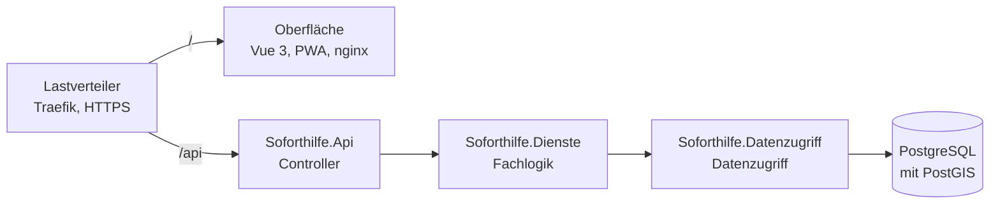
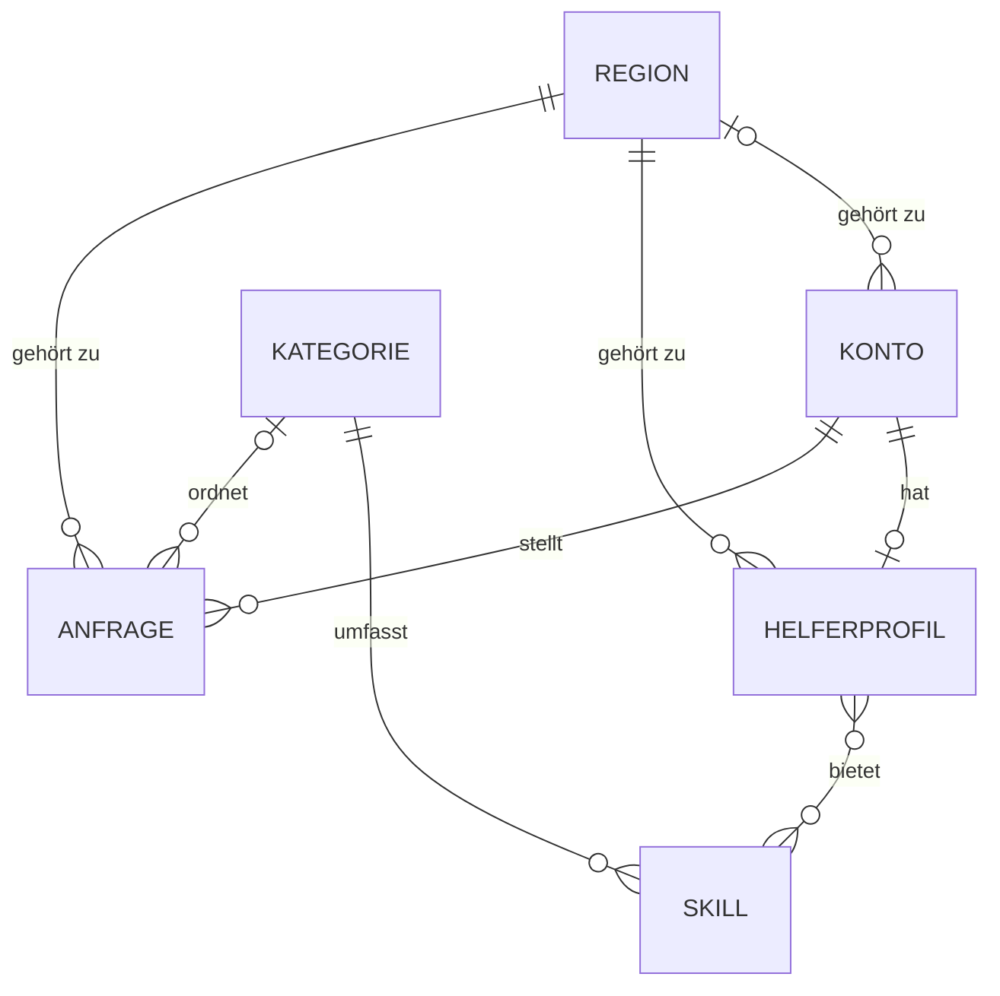

# Soforthilfe Bern/Mittelland

[](https://github.com/maliswiss/soforthilfe-bern-mittelland/actions/workflows/ci.yml)
[](LICENSE)

Hyperlokale Vermittlungsplattform für zeitkritische Alltagshilfe in Bern und Mittelland. HF Informatik, gibb Bern.

Hilfesuchende beschreiben ihre Lage in eigenen Worten. Die Plattform erkennt den Bedarf, stoppt bei gesundheitlichen Notfällen mit dem Hinweis «144 anrufen» und schlägt verifizierte Helfende aus der Nähe vor.

**Ziel:** Hilfesuchende erhalten in kurzer Zeit einen passenden, begründeten Vorschlag. Gesundheitliche Notfälle werden nie vermittelt, Standort- und Personendaten bleiben geschützt.

## Inhalt

- [Funktionen](#funktionen)
- [Architektur](#architektur)
- [Datenmodell](#datenmodell)
- [Technische Basis](#technische-basis)
- [Schnellstart](#schnellstart)
- [Entwicklung](#entwicklung)
- [Abgrenzung](#abgrenzung)
- [Drittkomponenten und Lizenz](#drittkomponenten-und-lizenz)
- [Autor](#-autor)

## Funktionen

| Funktion | Release | Stand |
|---|---|---|
| Mandantenfähigkeit: Regionen mit strikter Datentrennung | R1 | umgesetzt |
| Anmeldung mit JWT, Rollen und Berechtigungen | R1 | umgesetzt |
| Anfrage per Kategorie, Freitext oder beidem | R1 | umgesetzt |
| Ablehnung von Mehrwertnummern, Trennung kostenlos und kostenpflichtig | R1 | umgesetzt |
| Oberfläche: Startseite mit Kategorie oder Freitext, Regionswahl, Registrierung, Anmeldung, Anfrage erfassen, eigene Anfragen | R1 | umgesetzt |
| Containerplattform mit Docker Compose und Traefik | R1 | umgesetzt |
| Notfall-Stopp mit Hinweis «144 anrufen» | R2 | umgesetzt |
| Orte über das Ortschaftenverzeichnis von swisstopo, Standortfreigabe | R2 | geplant |
| Helferprofile mit Verifizierung und Preisangaben | R2 | geplant |
| Verständniskette: Kategorie, Regeln, TF-IDF-Klassifikator, Sprachmodell | R2 | geplant |
| Mehrsprachigkeit Deutsch und Französisch, Sprachimport ohne Deployment | R2 | geplant |
| Smart-Matching mit nachvollziehbarer Begründung | R2 | geplant |
| Auswahl, Zusage, Eskalation und Echtzeit-Hinweise | R3 | geplant |
| Chat je Anfrage | R3 | geplant |
| Abschluss, Vermittlungsgebühr, Bewertung und Auswertung | R3 | geplant |
| Datenschutz: gestaffelte Preisgabe, Auskunft, Löschung, Aufbewahrungsfristen | R3 | geplant |
| Redundanz mit zwei API-Instanzen, Sicherung, Überwachung, Alarmierung per Telegram | R3 | geplant |
| Sicherheitsprüfung nach OWASP Top 10 (Ausgabe 2025) | R3 | geplant |

Der Stand der einzelnen Aufgaben steht im [Kanban](https://github.com/users/maliswiss/projects/3).

## Architektur

Die Oberfläche ist eine Progressive Web App mit Vue 3 und ruft die Schnittstelle unter `/api` auf. In der Containerplattform nimmt Traefik alle Anfragen über HTTPS entgegen. Das Backend ist eine ASP.NET Core Web API in drei Schichten; jede Schicht ist ein eigenes Projekt und kennt nur die Schicht darunter.



Jede Region ist ein Mandant: Der Datenzugriff liest und schreibt nur Daten der Region der laufenden Anfrage. Details: [docs/mandanten.md](docs/mandanten.md).

Der vollständige Architektur- und Codeplan steht in [docs/architektur.md](docs/architektur.md).

## Datenmodell



Jede Region ist ein Mandant; Konten, Helferprofile und Anfragen gehören zu genau einer Region, nur der Plattformbetrieb arbeitet regionsübergreifend. Die Region Bern/Mittelland, zehn Kategorien und ihre Fähigkeiten kommen als Stammdaten mit den Migrationen; weitere Regionen entstehen im laufenden Betrieb. Kategorien sind entweder kostenlos oder kostenpflichtig. Eine Anfrage hält Postleitzahl und Ort getrennt von der genauen Adresse. Tabellen, Stammdaten und Entscheide: [docs/datenmodell.md](docs/datenmodell.md).

## Technische Basis

| Bereich | Technik |
|---|---|
| Backend | ASP.NET Core 10 (.NET 10), C# |
| Datenbank | PostgreSQL 16 mit PostGIS als Container, Entity Framework Core mit Npgsql |
| Anmeldung | JWT (HS256), Passwort-Hash mit PBKDF2 aus ASP.NET Core Identity |
| Frontend | Vue 3 mit Vue Router, Pinia und vue-i18n, Vite, Tailwind CSS, Progressive Web App mit vite-plugin-pwa |
| Betrieb | Docker Compose mit Profilen, Traefik 3 als Lastverteiler, nginx für die Oberfläche |
| Repository-Schutz | Gitleaks, Hygieneprüfung mit Node.js 22 und node:test |
| Tests | Einheitentests mit xUnit, Schnittstellentests mit node:test, Rauchtest mit curl und jq, Oberflächentests mit Playwright (Chromium, Desktop und Mobiltelefon) |
| CI | GitHub Actions, Dependabot |

## Schnellstart

Voraussetzungen: Docker, .NET SDK 10, Node.js 22 (ab 22.12), Git und Gitleaks.

```
git clone https://github.com/maliswiss/soforthilfe-bern-mittelland.git
cd soforthilfe-bern-mittelland
git config core.hooksPath .githooks
cp .env.example .env    # danach die Platzhalter ersetzen, JWT_KEY mit mindestens 32 Zeichen
docker compose up -d datenbank
dotnet tool restore
dotnet ef database update --project backend/src/Soforthilfe.Datenzugriff --startup-project backend/src/Soforthilfe.Api
dotnet run --project backend/src/Soforthilfe.Api
```

| Adresse | Antwort |
|---|---|
| `http://localhost:5000/api/info` | Name und Version |
| `http://localhost:5000/health/live` | `Healthy`, solange der Prozess läuft |
| `http://localhost:5000/health/ready` | `Healthy`, wenn auch die Datenbank erreichbar ist |

Oberfläche in einem zweiten Terminal starten; sie leitet `/api` an die Schnittstelle weiter:

```
cd frontend
npm ci
npm run dev
```

Die Oberfläche läuft unter `http://localhost:5173`. Ablauf und Bildschirme: [docs/screenflow.md](docs/screenflow.md).

Mit `Testdaten__Laden=true` in der `.env` lädt die Schnittstelle beim Start Testdaten mit ausschliesslich fiktiven Personen, sofern die Datenbank noch keine Konten enthält. Mit `TESTDATEN_PASSWORT` können sich die Testkonten anmelden.

**Neue Region einrichten** (ohne Deployment): Der Plattformbetrieb sendet `POST /api/mandanten` mit Schlüssel und Name, zum Beispiel `{ "schluessel": "thun", "name": "Soforthilfe Thun" }`. Die Region ist sofort nutzbar. Details: [docs/mandanten.md](docs/mandanten.md).

Registrierung, Anmeldung, Rollen und Berechtigungen: [docs/anmeldung-und-rollen.md](docs/anmeldung-und-rollen.md).

Alle Endpunkte, Fehlerantworten und Zahlenwerte: [docs/schnittstelle.md](docs/schnittstelle.md).

**Containerplattform** mit einem Befehl (Lastverteiler, Schnittstelle, Oberfläche, Datenbank):

```
docker compose --profile plattform up -d --build
```

Die Plattform läuft unter `https://localhost`; das lokale Zertifikat beim ersten Aufruf im Browser bestätigen. Beenden mit `docker compose --profile plattform down`. Details: [docs/containerplattform.md](docs/containerplattform.md).

Zugangsdaten gehören nie ins Repository; Vorlage für die lokale Konfiguration ist [`.env.example`](.env.example).

## Entwicklung

- **Kanban:** [Soforthilfe Bern/Mittelland Kanban](https://github.com/users/maliswiss/projects/3)
- **Aufgaben:** Jede Aufgabe ist ein Issue, jede Aufgabe ein Commit.
- **Commits:** `<Release>: <Kurzbeschreibung> (Refs #<Issue>)`, zum Beispiel `R1: Backend-Projektstruktur mit Schichten angelegt (Refs #4)`.
- **Tests:** Einheitentests im Ordner `backend` mit `dotnet test --solution Soforthilfe.slnx`; `node --test "tests/api/*.test.mjs"` gegen die laufende Schnittstelle (`API_URL`, Testkonten mit `TESTDATEN_PASSWORT`); Oberflächentests in `tests/oberflaeche` mit `npm ci`, `npx playwright install chromium` und `npx playwright test` gegen die laufende Oberfläche (`OBERFLAECHE_URL`, Standard `http://localhost:4173`). Die CI führt alle Tests bei jedem Push aus; Umfang und Ergebnisse von Release 1 stehen im [Testprotokoll](docs/testprotokoll-r1.md).
- **Prüfung vor dem Commit:** Hygieneprüfung und Gitleaks, Einrichtung mit `git config core.hooksPath .githooks`.
- **Releases und Tags:** R1 (19.10. bis 06.11.2026), R2 (09.11. bis 27.11.2026), R3 (30.11. bis 18.12.2026); jede Abnahme erhält den Tag `r1-abnahme`, `r2-abnahme` oder `r3-abnahme`. Release 1 ist abgenommen: [Abnahmeprotokoll](docs/abnahme-r1.md).

Alle Regeln stehen in [docs/commit-konvention.md](docs/commit-konvention.md).

**Nummerierung:** «Anforderung A…» (zum Beispiel «Anforderung A18») bezeichnet einen Punkt aus dem Anforderungskatalog. A01 bis A10 sind die Kategorien der [OWASP Top 10](https://owasp.org/Top10/) in der Ausgabe 2025. Die beiden Nummerierungen haben nichts miteinander zu tun.

## Abgrenzung

- Die Plattform ersetzt keinen Notruf und berät nicht medizinisch. Erkennt sie einen gesundheitlichen Notfall, verweist sie auf 144 und vermittelt nicht.
- Feuerwehr (118) und Polizei (117) sind bewusst nicht Teil der Notfallprüfung, weil Betroffene dort direkt anrufen.
- Für die Verifizierung werden keine Ausweisdokumente hochgeladen oder gespeichert.
- Die Plattform ist test- und pilotfähig; ein produktiver Betrieb ist nicht Teil des Projekts.
- Der Betrieb läuft lokal und containerbasiert. Eine Cloud ist eine Option für später, keine Zusage.

## Drittkomponenten und Lizenz

Der Quelltext steht unter der [MIT-Lizenz](LICENSE). Verwendete Drittkomponenten mit Zweck, Lizenz und Quelle stehen in [docs/drittkomponenten.md](docs/drittkomponenten.md).

## 👤 Autor

Mehmet Ali Gür, HF Informatik, gibb Bern
