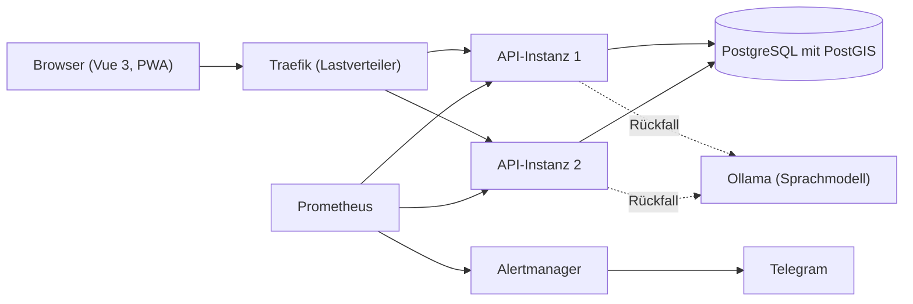

# Architektur- und Codeplan

Stand: Planung zu Beginn von Release 1. Das Dokument wächst mit dem Code und wird bei jeder Abnahme nachgeführt.

## Ziele

- Hilfesuchende erhalten in kurzer Zeit passende, verifizierte Helfende aus der Nähe.
- Gesundheitliche Notfälle werden erkannt und nie vermittelt: Die Plattform verweist auf 144.
- Standort- und Personendaten sind geschützt und werden nur so lange wie nötig aufbewahrt.
- Die Plattform ist redundant und skalierbar betreibbar.
- Jede Region ist ein eigener Mandant mit strikter Datentrennung.

## Übersicht

Bis Release 2 läuft eine API-Instanz. Zwei Instanzen hinter dem Lastverteiler, Sicherung und Überwachung kommen mit Release 3.

## Backend

ASP.NET Core 10 in drei Schichten:

| Schicht | Aufgabe |
|---|---|
| Controller | Schnittstelle, Eingabeprüfung, Berechtigungsprüfung |
| Dienste | Fachlogik: Verständniskette, Matching, Preise, Verifizierung |
| Datenzugriff | Entity Framework Core mit Npgsql, Migrationen, Mandantenfilter |

Die Lösung `backend/Soforthilfe.slnx` bildet die Schichten als eigene Projekte ab. Gemeinsame Einstellungen stehen in `backend/Directory.Build.props`, die SDK-Version in `backend/global.json`.

| Projekt | Schicht | Verweist auf |
|---|---|---|
| `Soforthilfe.Api` | Controller | `Soforthilfe.Dienste` |
| `Soforthilfe.Dienste` | Dienste | `Soforthilfe.Datenzugriff` |
| `Soforthilfe.Datenzugriff` | Datenzugriff | keine eigenen Projekte |

Die Schnittstelle registriert die Fachdienste über `AddDienste()`; diese binden den Datenzugriff mit `AddDatenzugriff()` ein. Controller verwenden nur Dienste und greifen nie direkt auf den Datenzugriff zu.

Querschnitt: Konfiguration aus der Umgebung, Zustandsprüfung, zentrale Fehlerbehandlung, Protokollierung ohne Personendaten.

## Daten

- PostgreSQL 16 mit PostGIS für Orte, Entfernungen und Suchradius.
- Jede Zeile gehört zu einer Region (Mandant). Der Datenzugriff filtert immer nach Region.
- Das Ortschaftenverzeichnis von swisstopo wird importiert und beim Start geladen.
- Testdaten enthalten ausschliesslich fiktive Personen.

## Rollen

Hilfesuchende, Helfende, Koordination, Mandantenadministration, Plattformbetrieb. Anmeldung mit JWT, Passwörter nur als Hash.

## Verständniskette

Eine Freitext-Anfrage durchläuft vier Stufen, die erste Stufe mit einer sicheren Entscheidung gewinnt:

1. Kategorieauswahl durch die hilfesuchende Person
2. Regeln mit Schlüsselwörtern, darunter die Notfallregeln
3. Maschinelles Lernen (TF-IDF) als Klassifikator
4. Sprachmodell (Ollama) als Rückfall

Der Weg der Klassifikation wird festgehalten. Bei einem gesundheitlichen Notfall stoppt die Kette und die Plattform zeigt «144 anrufen».

## Matching

1. Kandidatensuche nach Postleitzahl, Fähigkeit und Suchradius
2. Bewertung mit einstellbarer Gewichtung: Distanz, Fähigkeit, Bewertung, Verfügbarkeit, Erfahrung
3. Begründung zu jedem Vorschlag mit allen Teilwerten
4. Vorschau mit gestaffelter Preisgabe: Name nach der Registrierung, Telefonnummer nach der Zusage

## Echtzeit

SignalR für Hinweise und Chat. Bei mehreren API-Instanzen verteilt PostgreSQL die Nachrichten zwischen den Instanzen.

## Frontend

Vue 3 mit Vite, Tailwind CSS und PWA. Texte liegen als Sprachdateien vor (Deutsch, Französisch) und lassen sich ohne Deployment ergänzen.

## Betrieb

- Docker Compose mit Profilen, Traefik als Lastverteiler mit Zustandsprüfung und Wiederholung
- Migration beim Start mit Datenbanksperre
- Tägliche Sicherung mit automatischer Wiederherstellungsprobe
- Prometheus und Alertmanager mit Alarmierung per Telegram, Kennzahlen ohne Personendaten

## Sicherheit und Datenschutz

- Sicherheitsprüfung nach den OWASP Top 10 (Ausgabe 2025), Paketprüfung und ZAP-Scans
- Geheimnisse nur in der lokalen `.env`, Prüfung mit Gitleaks vor jedem Commit und in der CI
- Aufbewahrungsfristen mit automatischer Bereinigung, Auskunft und Löschung auf Anfrage

## Tests

| Ebene | Werkzeug | Verzeichnis |
|---|---|---|
| Schnittstelle | node:test | `tests/api` |
| Oberfläche | Playwright | `tests/e2e` |
| Last und Ausfall | Messskript | `tests/last` |
| Sicherheit | OWASP-Prüfungen, ZAP | `tests/sicherheit` |

Messungen und Testprotokolle liegen in `docs/messprotokolle/`.

## Konventionen

- Code, Kommentare und Oberflächentexte auf Deutsch mit korrekten Umlauten
- Commits nach [commit-konvention.md](commit-konvention.md)
- Ein Issue je Aufgabe, ein Commit je Aufgabe
