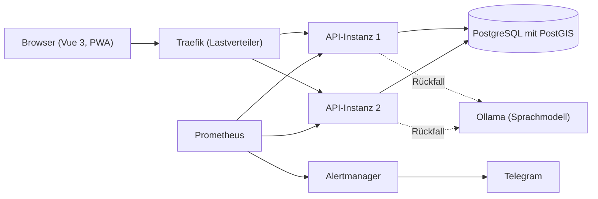

# Architektur- und Codeplan

Stand: Planung zu Beginn von Release 1. Das Dokument wächst mit dem Code und wird bei jeder Abnahme nachgeführt.

## Ziele

- Hilfesuchende erhalten in kurzer Zeit passende, verifizierte Helfende aus der Nähe.
- Gesundheitliche Notfälle werden erkannt und nie vermittelt: Die Plattform verweist auf 144.
- Standort- und Personendaten sind geschützt und werden nur so lange wie nötig aufbewahrt.
- Die Plattform ist redundant und skalierbar betreibbar.
- Jede Region ist ein eigener Mandant mit strikter Datentrennung.

## Übersicht

Bis Release 2 läuft eine API-Instanz. Zwei Instanzen hinter dem Lastverteiler, Sicherung und Überwachung kommen mit Release 3.

Die Containerplattform mit Lastverteiler, Schnittstelle, Oberfläche und Datenbank startet mit `docker compose --profile plattform up -d --build`. Aufbau, Profile und Sicherheitsköpfe: [containerplattform.md](containerplattform.md).

## Backend

ASP.NET Core 10 in drei Schichten:

| Schicht | Aufgabe |
|---|---|
| Controller | Schnittstelle, Eingabeprüfung, Berechtigungsprüfung |
| Dienste | Fachlogik: Verständniskette, Matching, Preise, Verifizierung |
| Datenzugriff | Entity Framework Core mit Npgsql, Migrationen, Mandantenfilter |

Die Lösung `backend/Soforthilfe.slnx` bildet die Schichten als eigene Projekte ab. Gemeinsame Einstellungen stehen in `backend/Directory.Build.props`, die SDK-Version und der Testläufer (Microsoft Testing Platform) in `backend/global.json`.

| Projekt | Schicht | Verweist auf |
|---|---|---|
| `Soforthilfe.Api` | Controller | `Soforthilfe.Dienste` |
| `Soforthilfe.Dienste` | Dienste | `Soforthilfe.Datenzugriff` |
| `Soforthilfe.Datenzugriff` | Datenzugriff | keine eigenen Projekte |

Die Schnittstelle registriert die Fachdienste über `AddDienste()`; diese binden den Datenzugriff mit `AddDatenzugriff()` ein. Controller verwenden nur Dienste und greifen nie direkt auf den Datenzugriff zu.

### Querschnitt

| Thema | Umsetzung |
|---|---|
| Konfiguration | Werte aus Umgebungsvariablen; in der Entwicklung zusätzlich aus der lokalen `.env` (Vorlage `.env.example`), ohne gesetzte Variablen zu überschreiben |
| Zustandsprüfung | `GET /health/live` meldet, ob der Prozess läuft; `GET /health/ready` führt alle Prüfungen mit dem Tag «bereit» aus |
| Fehlerbehandlung | Unbehandelte Ausnahmen und Statuscodes ohne Inhalt werden als `application/problem+json` beantwortet, ohne technische Details, mit Verfolgungsnummer |
| Protokollierung | Konsole, ausserhalb der Entwicklung als JSON; protokolliert werden Methode, Pfad und Verfolgungsnummer, keine Eingaben und keine Personendaten |
| Protokoll der Vorgänge | Sicherheitsrelevante Vorgänge wie der Notfall-Stopp stehen in der Tabelle `Protokoll`, je Region und ohne Personendaten ([notfallpruefung.md](notfallpruefung.md)) |
| Antwortköpfe | Kein `Server`-Kopf mit Produktname und Version |

## Daten

- PostgreSQL 16 mit PostGIS für Orte, Entfernungen und Suchradius.
- Lokal läuft die Datenbank als Container (`docker-compose.yml`, Dienst `datenbank`), nur auf `127.0.0.1` erreichbar.
- Die Verbindung entsteht aus den Umgebungswerten `POSTGRES_HOST`, `POSTGRES_PORT`, `POSTGRES_DB`, `POSTGRES_USER` und `POSTGRES_PASSWORD`.
- Das Schema entsteht ausschliesslich über Migrationen von Entity Framework Core (`backend/src/Soforthilfe.Datenzugriff/Migrations`); die erste Migration aktiviert PostGIS.
- `GET /health/ready` meldet erst `Healthy`, wenn die Datenbank erreichbar ist.
- Jede regionsbezogene Zeile gehört zu einer Region (Mandant). Der Datenzugriff filtert beim Lesen nach Region und prüft beim Schreiben, dass keine fremde Region betroffen ist. Details: [mandanten.md](mandanten.md).
- Das Ortschaftenverzeichnis von swisstopo wird importiert und beim Start geladen.
- Stammdaten (Regionen, Kategorien, Fähigkeiten) kommen mit festen Kennungen über die Migrationen in jede Datenbank.
- Testdaten enthalten ausschliesslich fiktive Personen mit Adressen auf `beispiel.invalid`. Sie werden nur mit `Testdaten__Laden=true` und nur in eine Datenbank ohne Konten geladen.
- Rollen und Status werden als Text gespeichert, damit die Daten auch ohne Code lesbar bleiben.

## Rollen

Hilfesuchende, Helfende, Koordination, Mandantenadministration, Plattformbetrieb. Anmeldung mit JWT, Passwörter nur als Hash.
Die Rolle wird an der Schnittstelle geprüft, die Region im Datenzugriff. Berechtigungen je Rolle: [anmeldung-und-rollen.md](anmeldung-und-rollen.md).

## Verständniskette

Vor jeder Einordnung prüfen feste Regeln den Text auf akute gesundheitliche Hinweise. Bei einem Treffer stoppt die Kette und die Plattform zeigt «144 anrufen» ([notfallpruefung.md](notfallpruefung.md)). Danach durchläuft eine Anfrage vier Stufen, die erste Stufe mit einer sicheren Entscheidung gewinnt:

1. Kategorieauswahl durch die hilfesuchende Person
2. Regeln mit Schlüsselwörtern
3. Maschinelles Lernen (TF-IDF) als Klassifikator
4. Sprachmodell (Ollama) als Rückfall

Der Weg der Klassifikation wird festgehalten.

## Matching

1. Kandidatensuche nach Postleitzahl, Fähigkeit und Suchradius
2. Bewertung mit einstellbarer Gewichtung: Distanz, Fähigkeit, Bewertung, Verfügbarkeit, Erfahrung
3. Begründung zu jedem Vorschlag mit allen Teilwerten
4. Vorschau mit gestaffelter Preisgabe: Name nach der Registrierung, Telefonnummer nach der Zusage

## Echtzeit

SignalR für Hinweise und Chat. Bei mehreren API-Instanzen verteilt PostgreSQL die Nachrichten zwischen den Instanzen.

## Frontend

Vue 3 mit Vite, Tailwind CSS und PWA, Zustand mit Pinia, Texte über vue-i18n. Ablauf und Bildschirme: [screenflow.md](screenflow.md).

| Ordner | Inhalt |
|---|---|
| `frontend/src/views` | Eine Ansicht je Seite, angebunden über `src/router/index.js` |
| `frontend/src/components` | Wiederverwendbare Teile wie Regionswahl, Hinweise, Status- und Dringlichkeitsmarke |
| `frontend/src/stores` | Pinia: Konto und Sitzung (`konto.js`), Entwurf der Anfrage (`anfrage.js`) |
| `frontend/src/api` | Aufruf der Schnittstelle (`klient.js`), Prüfung der Mehrwertnummern, sichere Weiterleitung nach der Anmeldung |
| `frontend/src/sprachen` | Alle Oberflächentexte in `de.json`; Zugriff nur über `t('bereich.schluessel')` |
| `frontend/public` | Symbole für Browser und installierte App |

- In der Entwicklung leitet Vite `/api` und `/health` an die Schnittstelle weiter; die Oberfläche läuft damit wie im Betrieb unter demselben Ursprung.
- Die PWA speichert nur die Oberfläche zwischen, nie Antworten der Schnittstelle.
- Schriften (Archivo, Source Sans 3) werden mit der Anwendung ausgeliefert; die Oberfläche lädt nichts von fremden Servern (Content-Security-Policy nur für den eigenen Ursprung, `frontend/csp.js` für die Vorschau, `frontend/nginx-sicherheit.conf` im Container).
- Die Region wählt die Person vor der Anmeldung; Registrierung und Anmeldung senden sie im Feld `mandant`, danach gilt die Region aus dem Token.
- Token und Konto liegen im lokalen Speicher des Browsers bis zum Ablauf des Tokens oder bis zur Abmeldung; lehnt die Schnittstelle das Token ab, führt die Oberfläche zur Anmeldung zurück.
- Seiten mit Anmeldung leiten zur Anmeldung und danach zurück, nur auf Pfade innerhalb der Anwendung; die Rolle prüft die Schnittstelle.
- Das Notfallband mit der Nummer 144 steht auf jeder Seite.

## Betrieb

- Docker Compose mit Profilen, Traefik als Lastverteiler mit Zustandsprüfung und Wiederholung
- Migration beim Start mit Datenbanksperre
- Tägliche Sicherung mit automatischer Wiederherstellungsprobe
- Prometheus und Alertmanager mit Alarmierung per Telegram, Kennzahlen ohne Personendaten

## Sicherheit und Datenschutz

- Sicherheitsprüfung nach den OWASP Top 10 (Ausgabe 2025), Paketprüfung und ZAP-Scans
- Geheimnisse nur in der lokalen `.env`, Prüfung mit Gitleaks vor jedem Commit und in der CI
- Aufbewahrungsfristen mit automatischer Bereinigung, Auskunft und Löschung auf Anfrage

## Tests

| Ebene | Werkzeug | Verzeichnis |
|---|---|---|
| Schnittstelle | node:test | `tests/api` |
| Oberfläche | Playwright | `tests/e2e` |
| Last und Ausfall | Messskript | `tests/last` |
| Sicherheit | OWASP-Prüfungen, ZAP | `tests/sicherheit` |

Messungen und Testprotokolle liegen in `docs/messprotokolle/`.

## Konventionen

- Code, Kommentare und Oberflächentexte auf Deutsch mit korrekten Umlauten
- Commits nach [commit-konvention.md](commit-konvention.md)
- Ein Issue je Aufgabe, ein Commit je Aufgabe
