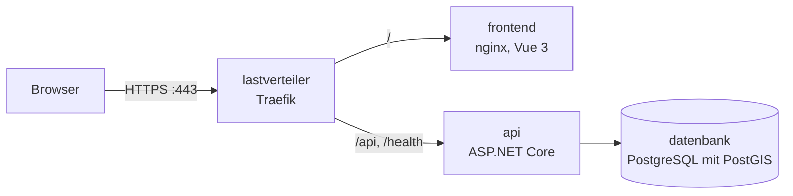

# Containerplattform

Die ganze Plattform startet lokal mit einem Befehl über Docker Compose. Der Lastverteiler Traefik nimmt alle Anfragen über HTTPS entgegen und leitet sie an die Oberfläche oder an die Schnittstelle weiter.

## Dienste

| Dienst | Image | Aufgabe | Erreichbar |
|---|---|---|---|
| `datenbank` | `postgis/postgis:16-3.4` | PostgreSQL mit PostGIS | `127.0.0.1:${POSTGRES_PORT}` |
| `api` | `soforthilfe-api:lokal` aus `backend/Dockerfile` | Schnittstelle, migriert das Schema beim Start | nur im Containernetz, Port 8080 |
| `frontend` | `soforthilfe-frontend:lokal` aus `frontend/Dockerfile` | Oberfläche als statische Dateien über nginx | nur im Containernetz, Port 8080 |
| `lastverteiler` | `traefik:v3.7` | HTTPS, Weiterleitung von HTTP auf HTTPS, Routen | Ports 80 und 443, Übersicht `127.0.0.1:8081` |

## Profile

| Aufruf | Startet | Zweck |
|---|---|---|
| `docker compose up -d datenbank` | `datenbank` | Entwicklung: Schnittstelle mit `dotnet run`, Oberfläche mit `npm run dev` |
| `docker compose --profile plattform up -d --build` | alle Dienste | Containerplattform unter `https://localhost` |
| `docker compose --profile plattform down` | | Plattform beenden, die Daten bleiben im Volume `datenbank` |

## Konfiguration

Alle Werte kommen aus der lokalen `.env` (Vorlage [`.env.example`](../.env.example)). Ohne `POSTGRES_PASSWORD` und `JWT_KEY` startet die Plattform nicht. Innerhalb des Containernetzes erreicht die Schnittstelle die Datenbank unter `datenbank:5432`, unabhängig vom lokalen `POSTGRES_PORT`. Die Schnittstelle läuft im Container in der Umgebung `Production` und liest keine `.env`-Datei.

## Zertifikat

Lokal verwendet Traefik ein selbst erzeugtes Zertifikat, das beim Start im Container entsteht. Der Browser warnt einmal; danach ist die Seite über HTTPS erreichbar. Im Repository liegt weder ein Zertifikat noch ein Schlüssel.

## Sicherheit

| Massnahme | Umsetzung |
|---|---|
| Nur HTTPS | Traefik leitet Port 80 auf 443 um, HSTS über den Kopf `Strict-Transport-Security` |
| Sicherheitsköpfe | `Content-Security-Policy` nur für den eigenen Ursprung, `X-Frame-Options`, `X-Content-Type-Options`, `Referrer-Policy`, `Permissions-Policy` ([`frontend/nginx-sicherheit.conf`](../frontend/nginx-sicherheit.conf), [`deploy/traefik/dynamisch.yml`](../deploy/traefik/dynamisch.yml)) |
| Ohne Administratorrechte | Schnittstelle und nginx laufen im Container als gewöhnlicher Benutzer |
| Kleine Images | Laufzeit-Images ohne SDK und ohne Build-Werkzeuge |
| Keine Geheimnisse im Image | `.dockerignore` schliesst `.env`, Build-Ausgaben und Entwicklungseinstellungen aus |
| Datenbank nur lokal | Port der Datenbank nur auf `127.0.0.1` |

## Prüfung in der CI

Der Job «Containerplattform starten» baut alle Images, startet die Plattform mit einem Befehl und prüft über `https://localhost` die Zustandsprüfung, die Schnittstelle, die Oberfläche mit ihren Sicherheitsköpfen und die Umleitung von HTTP auf HTTPS.
