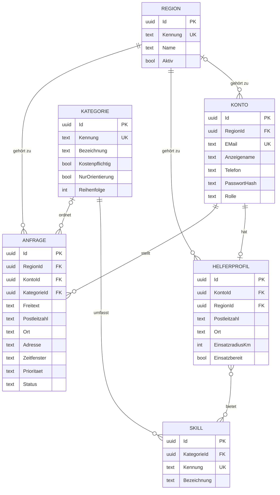

# Datenmodell

Die Daten liegen in PostgreSQL mit PostGIS. Das Schema entsteht ausschliesslich über die Migrationen von Entity Framework Core in [`backend/src/Soforthilfe.Datenzugriff/Migrations`](../backend/src/Soforthilfe.Datenzugriff/Migrations).

## Übersicht

## Tabellen

| Tabelle | Inhalt | Region |
|---|---|---|
| `Regionen` | Mandanten der Plattform | ist selbst die Region |
| `Konten` | Personen mit Rolle, E-Mail-Adresse, Passwort-Hash und freiwilliger Telefonnummer | genau eine; der Plattformbetrieb hat keine |
| `Kategorien` | Kategorien der Startseite, kostenlos oder kostenpflichtig | für alle Regionen gleich |
| `Skills` | Fähigkeiten je Kategorie | für alle Regionen gleich |
| `Helferprofile` | Einsatzgebiet, Radius und Fähigkeiten helfender Personen | genau eine |
| `HelferprofilSkills` | Zuordnung Profil zu Fähigkeit | über das Profil |
| `Anfragen` | Anliegen mit Kategorie und/oder Freitext, Ort, Zeitfenster, Dringlichkeit und Status | genau eine |

## Stammdaten

Stammdaten kommen mit festen Kennungen über die Migrationen in jede Datenbank.

| Art | Inhalt |
|---|---|
| Region | `bern-mittelland` (Soforthilfe Bern/Mittelland) |
| Kategorien, kostenpflichtig | Schlüsseldienst, Kleine Reparatur, Sanitär/Heizung/Elektro, Panne und Abschleppdienst, Transport- und Umzugshilfe, IT- und Handy-Soforthilfe, Reinigung nach Schäden, Lieferung Apotheke und Einkauf |
| Kategorien, kostenlos | Nachbarschaftshilfe, Begleitung und Orientierung |
| Fähigkeiten | je Kategorie eine Fähigkeit mit derselben Kennung |

Weitere Regionen entstehen im laufenden Betrieb als Daten (`POST /api/mandanten`), nicht als Migration. Die Testdaten legen auf diesem Weg die zweite Region `biel-seeland` an.

## Entscheide zum Modell

| Nr. | Entscheid | Begründung |
|---|---|---|
| 1 | Konten, Helferprofile und Anfragen tragen eine `RegionId` | Mandantentrennung auf Datenebene, Filter und Schreibprüfung im Datenbankkontext |
| 2 | Kategorien und Fähigkeiten gelten für alle Regionen | eine gemeinsame Auswahl, keine Doppelungen |
| 3 | `Adresse` getrennt von `Postleitzahl` und `Ort` | die genaue Adresse wird später erst nach der Zusage ausgeliefert |
| 4 | `Kostenpflichtig` je Kategorie | strikte Trennung kostenloser und kostenpflichtiger Angebote (Anforderung A12) |
| 5 | `NurOrientierung` je Kategorie | gesundheitliche Anliegen bleiben auf Orientierung, Transport und Begleitung begrenzt |
| 6 | Rolle, Status und Dringlichkeit als Text gespeichert | Daten bleiben ohne Code lesbar; an der Schnittstelle gelten feste Zahlenwerte |
| 7 | Eine E-Mail-Adresse gehört plattformweit zu genau einem Konto | eindeutige Anmeldung, keine Verwechslung zwischen Regionen |
| 8 | Nur der Passwort-Hash wird gespeichert | kein Klartext, auch nicht in Testdaten |

## Testdaten

Mit `Testdaten__Laden=true` lädt die Schnittstelle beim Start fiktive Daten in eine Datenbank ohne Konten: acht Konten auf `beispiel.invalid` in beiden Regionen und im Plattformbetrieb, drei Helferprofile und zwei Anfragen. Die CI prüft die Anzahl der Zeilen je Tabelle.
