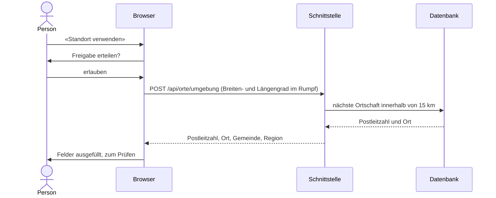

# Orte, Postleitzahlen und Standort

Orte und Postleitzahlen stammen aus dem amtlichen Ortschaftenverzeichnis der Schweiz von swisstopo. Die Plattform liest es selbst ein und fragt keinen fremden Dienst ab, auch nicht für den Standort.

## Datenquelle

| Angabe | Wert |
|---|---|
| Quelle | Amtliches Ortschaftenverzeichnis mit Postleitzahl, swisstopo |
| Ausgabe | 01.09.2026, CSV mit Koordinaten in WGS84, Trennzeichen `;` |
| Datei | [`backend/src/Soforthilfe.Datenzugriff/Daten/`](../backend/src/Soforthilfe.Datenzugriff/Daten) |
| Umfang | 5718 Zeilen: Ortschaft (Postleitzahl und Zusatzziffer) je berührte Gemeinde |
| Nutzung | freie Nutzung, Quellenangabe Pflicht; die Oberfläche nennt «© swisstopo» in der Fusszeile |
| Bezug | [swisstopo](https://www.swisstopo.admin.ch/de/amtliches-ortschaftenverzeichnis), [opendata.swiss](https://opendata.swiss/de/dataset/amtliches-ortschaftenverzeichnis-mit-postleitzahl-und-perimeter) |

## Einlesen

1. Beim Start prüft die Schnittstelle, ob die Tabelle `Ortschaften` leer ist.
2. Eine Sperre in der Datenbank sorgt dafür, dass bei mehreren Instanzen nur eine einliest.
3. Gelesen wird die neueste Datei `amtliches_ortschaftenverzeichnis_wgs84*.csv` im Ordner `Daten` neben der Anwendung; `Ortschaften__Datei` kann eine andere Datei angeben.
4. Fehlt eine Pflichtspalte oder ist ein Wert unlesbar, wird nichts gespeichert. Die Schnittstelle startet trotzdem und meldet den Fehler im Anwendungsprotokoll.
5. Nach dem Einlesen steht im Protokoll der Eintrag `Ortschaften.Eingelesen` mit Anzahl und Dateiname.

| Spalte der Datei | Feld in `Ortschaften` |
|---|---|
| `PLZ4`, `Zusatzziffer` | `Postleitzahl`, `Zusatzziffer` |
| `Ortschaftsname` | `Name` |
| `Gemeindename`, `BFS-Nr` | `Gemeinde`, `BfsNummer` |
| `Kantonskürzel` | `Kanton` |
| `Adressenanteil` | `Adressenanteil` in Prozent |
| `E`, `N` | `Standort` als Punkt (Länge, Breite) mit räumlichem Index |
| `Sprache` | `Sprache` |

## Postleitzahl-Zuordnung

`GET /api/orte?plz=` liefert je Ortschaft der Postleitzahl einen Eintrag mit Ort, Gemeinde, Kanton und Region.

| Regel | Umsetzung |
|---|---|
| Gemeinde einer Ortschaft | die Gemeinde mit dem grössten Anteil der Adressen |
| Hinweis «mehrere Gemeinden» | wenn mindestens zwei Gemeinden je mindestens 3 % der Adressen der Postleitzahl stellen; kleinere Splitter am Rand zählen nicht |
| Region | die aktive Region, zu deren Gemeinden (`Regionen.Gemeinden`) die Gemeinde gehört, sonst leer |
| Unbekannte Postleitzahl | leere Liste |
| Ort in der Oberfläche | nach der Eingabe der Postleitzahl ergänzt; weitere Ortschaften stehen zur Auswahl |

| Beispiel | Ergebnis |
|---|---|
| 3011 | Bern, Gemeinde Bern, Region `bern-mittelland` |
| 3086 | Zimmerwald und Englisberg, beide Gemeinde Wald (BE) |
| 3174 | Thörishaus, Gemeinde Köniz (59 %) und Neuenegg (41 %): Hinweis «mehrere Gemeinden» |
| 3053 | Münchenbuchsee (`bern-mittelland`) und Lätti, Gemeinde Rapperswil (BE) (`biel-seeland`) |
| 8001 | Zürich, keine Region |

## Region aus der Postleitzahl

Eine Regionswahl gibt es in der Oberfläche nicht. Bei der Registrierung bestimmt die Postleitzahl die Region des Kontos; gespeichert wird die Postleitzahl dafür nicht. Steht sie nicht im Verzeichnis oder in keiner Region, wird die Registrierung mit einem Hinweis nicht gesendet. Die Anmeldung braucht keine Region, sie gilt in der Region des Kontos.

Eine Anfrage nimmt die Schnittstelle nur mit einer Postleitzahl an, die im Verzeichnis steht und mindestens eine Gemeinde der Region des Kontos berührt; sonst folgt `400` mit `"feld": "plz"`. Postleitzahlen an der Grenze zweier Regionen sind damit in beiden Regionen möglich.

Die Gemeinden der Regionen sind die BFS-Gemeindenummern der Verwaltungskreise des Kantons Bern, abgeglichen mit dieser Ausgabe des Verzeichnisses: Bern-Mittelland (74 Gemeinden) für `bern-mittelland`, Biel/Bienne (19) und Seeland (42) für `biel-seeland`. Gemeindefusionen erfordern einen Abgleich mit der neuen Ausgabe.

## Standortfreigabe

Statt Postleitzahl und Ort einzutippen, kann die Person «Standort verwenden» wählen. Der Standort wird nur verwendet, wenn sie ihn im Browser freigibt, und nur über die eigene Schnittstelle in Postleitzahl und Ort übersetzt.

| Schutz | Umsetzung |
|---|---|
| Nur nach Freigabe | Abfrage erst nach Klick; der Browser fragt um Erlaubnis; ohne Freigabe bleibt die Eingabe von Hand |
| Nur eigene Schnittstelle | keine Karten- oder Ortungsdienste Dritter; `Content-Security-Policy` erlaubt Verbindungen nur zum eigenen Ursprung, `Permissions-Policy: geolocation=(self)` |
| Nicht in Adressen | Koordinaten nur im Rumpf eines `POST`; `GET` auf denselben Pfad ergibt `405`, damit sie nie in Zugriffsprotokollen stehen |
| Nicht gespeichert | weder in der Datenbank, im Protokoll, im Anwendungsprotokoll noch im Speicher des Browsers; weitergegeben werden nur Postleitzahl und Ort |
| Genauigkeit | geringe Genauigkeit genügt (`enableHighAccuracy: false`); ist der Standort ungenauer als 1 km, weist die Oberfläche darauf hin |
| Ausland | liegt keine Ortschaft näher als 15 km, folgt `404` mit dem Hinweis, Postleitzahl und Ort einzutragen |
| Sichere Verbindung | der Browser gibt den Standort nur über HTTPS oder `localhost` heraus |

## Neue Ausgabe

swisstopo veröffentlicht das Verzeichnis regelmässig neu. Für eine neue Ausgabe die Datei im Ordner `Daten` ersetzen, die Tabelle leeren (`TRUNCATE "Ortschaften"`) und die Schnittstelle neu starten; das Verzeichnis wird dann neu eingelesen.

## Tests

| Test | Prüft |
|---|---|
| Einheitentests `OrtschaftenverzeichnisTests` | Format, Koordinaten in der richtigen Reihenfolge, mehrere Gemeinden je Ortschaft, Abbruch bei fehlender Spalte oder ungültigem Wert, Vollständigkeit der mitgelieferten Ausgabe |
| CI, Schritt «Stammdaten und Testdaten prüfen» | 5718 Zeilen in `Ortschaften` und der Protokolleintrag nach dem Start |
| Schnittstellentests `tests/api/orte.test.mjs` | Ort, Gemeinde, Kanton und Region zur Postleitzahl, mehrere Ortschaften, Hinweis «mehrere Gemeinden», Postleitzahlen ausserhalb der Regionen, ungültige Eingaben, Anfrage nur in der eigenen Region; Standort ergibt Postleitzahl ohne Koordinaten in der Antwort, Ausland, ungültige Koordinaten, keine Koordinaten in der Adresse |
| Rauchtest | `GET /api/orte` mit Region, Hinweis, unbekannter und ungültiger Postleitzahl; Anfrage ausserhalb der Region; Standort Bundesplatz, Ausland, `405` mit Koordinaten in der Adresse |
| Oberflächentests | Quellenangabe «© swisstopo» in der Fusszeile, Ort ergänzt, Hinweis «mehrere Gemeinden», Region aus der Postleitzahl bei der Registrierung, Anmeldung ohne Regionswahl; «Standort verwenden» nur auf Klick, ein `POST` an die eigene Schnittstelle, keine fremden Ziele, nichts im Speicher des Browsers, Hinweis im Ausland und ohne Freigabe |
