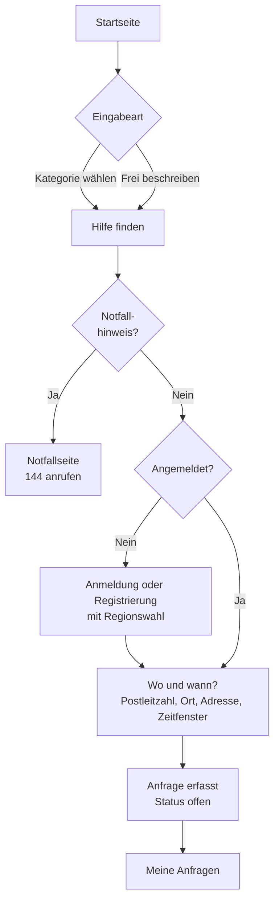

# Screenflow und Bildschirme

Ablauf der Oberfläche von der Startseite über Regionswahl und Anmeldung bis zur erfassten Anfrage (Release 1).

## Grundsätze der Oberfläche

| Nr. | Grundsatz | Begründung |
|---|---|---|
| 1 | Rotes Notfallband mit «Jetzt 144 anrufen» auf jeder Seite | Abgrenzung: keine medizinischen Leistungen |
| 2 | Support-Block im Fussbereich, getrennt vom Notfallband | Notfall und Anwendungsstörung dürfen nicht verwechselt werden |
| 3 | Anfrage ohne Anmeldung beginnen, Anmeldung erst vor dem Absenden | niedrige Einstiegshürde, trotzdem nachvollziehbare Identität |
| 4 | Genaue Adresse getrennt von Postleitzahl und Ort | Schutz von Standort- und Personendaten |
| 5 | Region jederzeit erkennbar, vor der Anmeldung wählbar | Mandantenfähigkeit, Datentrennung je Region |
| 6 | Das Eingabefeld ist das auffälligste Element der Startseite | der erste Schritt soll ohne Suchen auffindbar sein |

## Gesamtablauf Release 1

Die Eingabe der Startseite bleibt während Anmeldung oder Registrierung im Entwurf erhalten; danach geht es direkt zu «Wo und wann?».

## Bildschirme

| Nr. | Bildschirm | Pfad | Zugriff | Zweck |
|---|---|---|---|---|
| 01 | Startseite | `/` | offen | Einstieg: Kategorie aus zehn Kacheln oder Anliegen in eigenen Worten, Hinweise für Helfende und zu Vertrauen und Schutz |
| 02 | Anmeldung | `/anmeldung` | offen | Region, E-Mail-Adresse und Passwort; danach zurück zum gewünschten Ziel |
| 03 | Registrierung | `/registrierung` | offen | Region, «Hilfe suchen» oder «Hilfe anbieten», Name, E-Mail-Adresse, freiwillige Telefonnummer, Passwort |
| 04 | Wo und wann? | `/anfrage/erfassen` | angemeldet | Postleitzahl, Ort, Adresse und Zeitfenster zur Anfrage |
| 05 | Anfrage | `/anfragen/:id` | angemeldet | Kategorie, Status, Dringlichkeit, Ort, Beschreibung, kostenlos oder kostenpflichtig |
| 06 | Meine Anfragen | `/anfragen` | angemeldet | eigene Anfragen, neueste zuerst |
| 07 | So funktioniert es | `/so-funktioniert-es` | offen | Ablauf in vier Schritten und Abgrenzung |
| 08 | Notfall | `/notfall` | offen | Notfall-Stopp: «Bitte sofort 144 anrufen», Anrufknopf und Abgrenzung |

## Navigation

| Zustand | Kopfzeile |
|---|---|
| Ohne Anmeldung | Logo mit Region · Regionswahl · So funktioniert es · Für Helfende · Anmelden |
| Hilfesuchende | Logo mit Region · So funktioniert es · Meine Anfragen · Name · Abmelden |
| Andere Rollen | Logo mit Region · So funktioniert es · Name · Abmelden |

«Für Helfende» öffnet die Registrierung mit vorgewählter Kontoart «Hilfe anbieten».

## Prüfungen in der Oberfläche

| Stelle | Prüfung | Meldung |
|---|---|---|
| Startseite | Kategorie gewählt oder Beschreibung mit mindestens zehn Zeichen | «Bitte wählen Sie eine Kategorie.» oder «Bitte beschreiben Sie Ihr Anliegen in einem kurzen Satz.» |
| Registrierung | Mehrwertnummer schon während der Eingabe erkannt (Anforderung A10) | roter Hinweis unter dem Feld, die Registrierung wird nicht gesendet |
| Anmeldung | gleiche Meldung für falsches Passwort, unbekannte Adresse und fremde Region | «E-Mail-Adresse oder Passwort ist falsch.» mit dem Hinweis, die Region zu prüfen |
| Wo und wann? | vierstellige Postleitzahl, Ort ausgefüllt | Hinweis über dem Knopf |

Massgebend bleibt die Schnittstelle; ihre Meldungen (Feld `fehler`) erscheinen unverändert in der Oberfläche.

## Gestaltung

| Nr. | Entscheid | Begründung |
|---|---|---|
| 1 | Farbpalette Tannengrün, Papierweiss, Kiesel, Notrufrot | ruhige, zivile Anmutung; Rot bleibt allein dem Notfall vorbehalten |
| 2 | Archivo für Titel, Source Sans 3 für Text | gut lesbar in kleinen Grössen, klar unterscheidbar |
| 3 | Kein Schlagschatten, klare Linien statt Kacheloptik | die Oberfläche soll sachlich wirken |
| 4 | Status und Dringlichkeit als Marke mit Wort, nie nur als Farbe | auch ohne Farbwahrnehmung verständlich |
| 5 | Ansicht für Mobilgeräte zuerst, Raster ab mittlerer Breite | Hilfesuchende sind oft unterwegs |

Die Farben und Schriften stehen in [`frontend/src/style.css`](../frontend/src/style.css), alle Texte in [`frontend/src/sprachen/de.json`](../frontend/src/sprachen/de.json).
