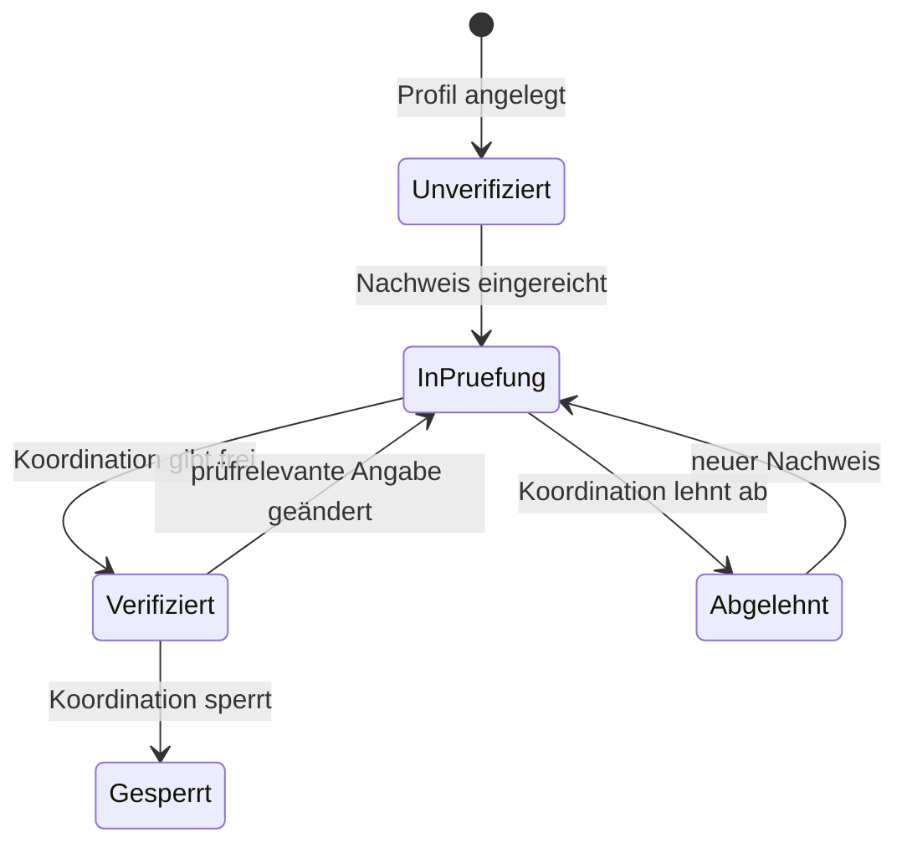

# Verifizierung

Helfende Personen und Betriebe weisen nach, wer sie sind, bevor die Koordination ihrer Region das Helferprofil freigibt. Die Plattform stützt sich dafür nur auf überprüfbare Angaben. Ausweisdokumente, Fotos oder andere Dateien nimmt sie nicht entgegen und speichert sie nicht.

## Nachweisarten

| Art | Wert | Prüfung beim Einreichen | Stand |
|---|---|---|---|
| `0` UID-Nummer | `CHE-123.456.788` | Format und Prüfziffer | umgesetzt |
| `1` Handelsregister | UID des eingetragenen Unternehmens, zum Beispiel `CHE-123.456.788 HR` | Format und Prüfziffer; den Eintrag prüft die Koordination im Handelsregister (Zefix) | umgesetzt |
| `2` bestätigte Telefonnummer | `031 123 45 67`; ohne Angabe die Nummer des Kontos | Schweizer Nummer, keine Mehrwertnummer (Anforderung A10); die Koordination bestätigt sie mit einem Rückruf | umgesetzt |
| `3` bestätigte E-Mail-Adresse | immer die Adresse des Kontos | eine andere Adresse wird abgewiesen; die Koordination bestätigt sie mit einer Nachricht an diese Adresse | umgesetzt |
| `4` Referenz | Organisation oder Gemeinde mit Kontaktperson, zum Beispiel `Gemeinde Muri, Frau Muster` | 5 bis 200 Zeichen; die Koordination fragt bei der Referenz nach | umgesetzt |

Eine unbekannte Art ergibt `400` mit `"feld": "art"`.

## UID-Nummer

Die Unternehmens-Identifikationsnummer besteht aus «CHE» und neun Ziffern; die letzte ist eine Prüfziffer.

| Schritt | Regel |
|---|---|
| Format | `CHE-123.456.788`, `CHE123456788` oder mit Leerzeichen; Gross- und Kleinschreibung egal; ein Zusatz `HR`, `MWST`, `TVA`, `IVA`, `RC` oder `RI` ist erlaubt |
| Prüfziffer | Summe der ersten acht Ziffern mal 5, 4, 3, 2, 7, 6, 5, 4; Prüfziffer = 11 − (Summe mod 11); 11 wird zu 0, 10 gibt es nicht |
| Gespeichert | immer in der Form `CHE-123.456.788`, ohne Zusatz |

Beispiel `CHE-123.456.788`: 1·5 + 2·4 + 3·3 + 4·2 + 5·7 + 6·6 + 7·5 + 8·4 = 168; 168 mod 11 = 3; 11 − 3 = 8.

## Telefonnummer, E-Mail-Adresse und Referenz

Bestätigungscodes per SMS oder E-Mail verschickt die Plattform nicht, weil sie im Pilot keinen Versand anbietet. Bestätigt sind Telefonnummer und E-Mail-Adresse, wenn die Koordination sie erreicht hat und den Nachweis freigibt.

| Art | Regel | Gespeichert |
|---|---|---|
| Telefonnummer | `+41`, `0041` und übliche Trennzeichen sind erlaubt; Mehrwertnummern (`0900`, `0901`, `0906`) ergeben `400` mit dem Titel «Kostenpflichtige Telefonnummer»; ohne Angabe und ohne Nummer im Konto fehlt der Wert | `031 123 45 67` |
| E-Mail-Adresse | ohne Angabe oder mit der Adresse des Kontos in beliebiger Schreibweise; eine andere Adresse ergibt `400` | Adresse des Kontos |
| Referenz | Leerzeichen und Zeilenumbrüche werden zu einfachen Leerzeichen; unter 5 oder über 200 Zeichen ergibt `400` | vereinheitlichter Text |

## Ablauf



Ein abgelehnter Zusatznachweis ändert ein verifiziertes Profil nicht; solange weitere Nachweise offen sind, bleibt das Profil in Prüfung.

| Regel | Umsetzung |
|---|---|
| Status des Profils | `verifizierung` im Helferprofil: 0 unverifiziert, 1 in Prüfung, 2 verifiziert, 3 abgelehnt, 4 gesperrt |
| Einreichen | setzt den Nachweis und das Profil auf «in Prüfung» |
| Erneut einreichen | ein offener Nachweis derselben Art wird ersetzt, nicht verdoppelt |
| Prüfrelevante Änderung | ändern sich Typ, Betriebsname, Postleitzahl, Ort, Adresse oder Fähigkeiten eines verifizierten Profils, steht es wieder in Prüfung, und die freigegebenen Nachweise liegen der Koordination erneut vor; Preise, Beschreibung und Radius nicht |
| Gesperrt | ein gesperrtes Profil kann keine Nachweise einreichen (`403`); ein Entscheid hebt die Sperre nicht auf |
| Freigabe | die Koordination der Region gibt einen offenen Nachweis frei; das Profil ist damit verifiziert |
| Ablehnung | ohne weitere offene Nachweise und ohne anderen freigegebenen Nachweis ist das Profil abgelehnt; ein neuer Nachweis bringt es wieder in Prüfung |
| Bemerkung | freiwillig, höchstens 500 Zeichen; die helfende Person sieht sie bei ihren Nachweisen |
| Einmal entscheiden | ein bereits entschiedener Nachweis ergibt `409` |

## Prüfung durch die Koordination

| Nachweis | Was die Koordination prüft |
|---|---|
| UID-Nummer | Eintrag im UID-Register: Name und Sitz passen zu Betriebsname und Ort im Profil |
| Handelsregister | Eintrag im Handelsregister (Zefix), aktiv und zum Betrieb passend |
| Telefonnummer | Rückruf an die angegebene Nummer |
| E-Mail-Adresse | Nachricht an die Adresse des Kontos und Antwort darauf |
| Referenz | Rückfrage bei der genannten Organisation oder Gemeinde |

Die Liste der offenen Nachweise zeigt dafür zu jedem Nachweis Typ, Betriebsname, Postleitzahl und Ort des Profils sowie dessen Stand.

## Datenschutz

| Schutz | Umsetzung |
|---|---|
| Keine Ausweisdokumente | die Schnittstelle nimmt nur JSON an; ein Upload (`multipart/form-data`) ergibt `415`, nichts wird gespeichert |
| Nur nötige Angaben | gespeichert werden Art, normalisierter Wert, Status, Zeitpunkte und eine Bemerkung der Koordination |
| Mandantentrennung | jeder Nachweis trägt die Region des Profils; die Koordination sieht nur ihre Region |
| Protokoll | `Verifizierung.Eingereicht`, `Verifizierung.Freigegeben` und `Verifizierung.Abgelehnt` mit Kennung und Art, ohne den Wert und ohne die Bemerkung |

## Schnittstelle

| Methode | Pfad | Rolle | Zweck |
|---|---|---|---|
| POST | `/api/verifizierungen` | Helfende | Nachweis einreichen |
| GET | `/api/verifizierungen/meine` | Helfende | eigene Nachweise, neueste zuerst |
| GET | `/api/verifizierungen/offen` | Koordination | offene Nachweise der eigenen Region, älteste zuerst |
| POST | `/api/verifizierungen/{id}/entscheid` | Koordination | freigeben oder ablehnen |

```
POST /api/verifizierungen
Authorization: Bearer <token>
Content-Type: application/json

{ "art": 0, "nachweiswert": "che 123 456 788" }
```

Antwort `200`:

```
{ "id": "…", "helferProfilId": "…", "anzeigename": "…", "art": 0, "nachweiswert": "CHE-123.456.788",
  "status": 1, "bemerkung": null, "eingereichtAm": "…", "geprueftAm": null }
```

Ohne Helferprofil folgt `400`; ein fehlender oder ungültiger Wert ergibt `400` mit `"feld": "nachweiswert"`.

```
POST /api/verifizierungen/{id}/entscheid
Authorization: Bearer <token der Koordination>
Content-Type: application/json

{ "freigeben": true, "bemerkung": "Eintrag im Handelsregister geprüft" }
```

Antwort `200` mit dem Nachweis (`status` 2 oder 3, `geprueftAm`). In der Liste `GET /api/verifizierungen/offen` stehen zusätzlich `typ`, `betriebsname`, `plz`, `ort` und `profilstatus`.

## Tests

| Test | Prüft |
|---|---|
| Einheitentests `UidTests` | gültige Schreibweisen, Normalisierung, Prüfziffer 0, falsche Prüfziffer, nicht vergebene Nummern (Rechnung 10), falsche Formate |
| Einheitentests `NachweiswerteTests` | Telefonnummer in allen Schreibweisen, ungültige Nummern, Referenz vereinheitlichen, Mindest- und Höchstlänge |
| Einheitentests `ProfilstatusTests` | Stand des Profils nach Freigabe und Ablehnung, mit offenen oder freigegebenen weiteren Nachweisen, Sperre bleibt |
| Schnittstellentests `tests/api/freigabe.test.mjs` | Rollen, Liste mit Profilangaben und Reihenfolge, Freigabe mit Bemerkung und Protokoll ohne Wert, Ablehnung, Zusatznachweis, erneute Prüfung nach prüfrelevanter Änderung, fremde Region `404`, zweiter Entscheid `409`, Länge der Bemerkung |
| Schnittstellentests `tests/api/verifizierung.test.mjs` | Rollen, ohne Profil, UID und Handelsregister, Telefonnummer aus dem Konto oder angegeben, Mehrwertnummern, E-Mail-Adresse nur die des Kontos, Referenz, Profil in Prüfung, ungültige Nachweise ohne Speicherung, Ersetzen statt Verdoppeln, Upload abgewiesen (`415`), Protokoll ohne Wert |
| Rauchtest | UID einreichen und normalisieren, falsche Prüfziffer, Upload abgewiesen, Referenz, Mehrwertnummer abgewiesen, offene Nachweise nur für die Koordination, Freigabe, Profil verifiziert, zweiter Entscheid, fremde Region |

## Testdaten

| Konto | Profil | Nachweis |
|---|---|---|
| Bruno Muster | verifiziert | E-Mail-Adresse, freigegeben durch die Koordination Bern/Mittelland |
| Clara Fiktiv | in Prüfung | Referenz, offen |
| Fritz Platzhalter | nicht verifiziert | keiner |
