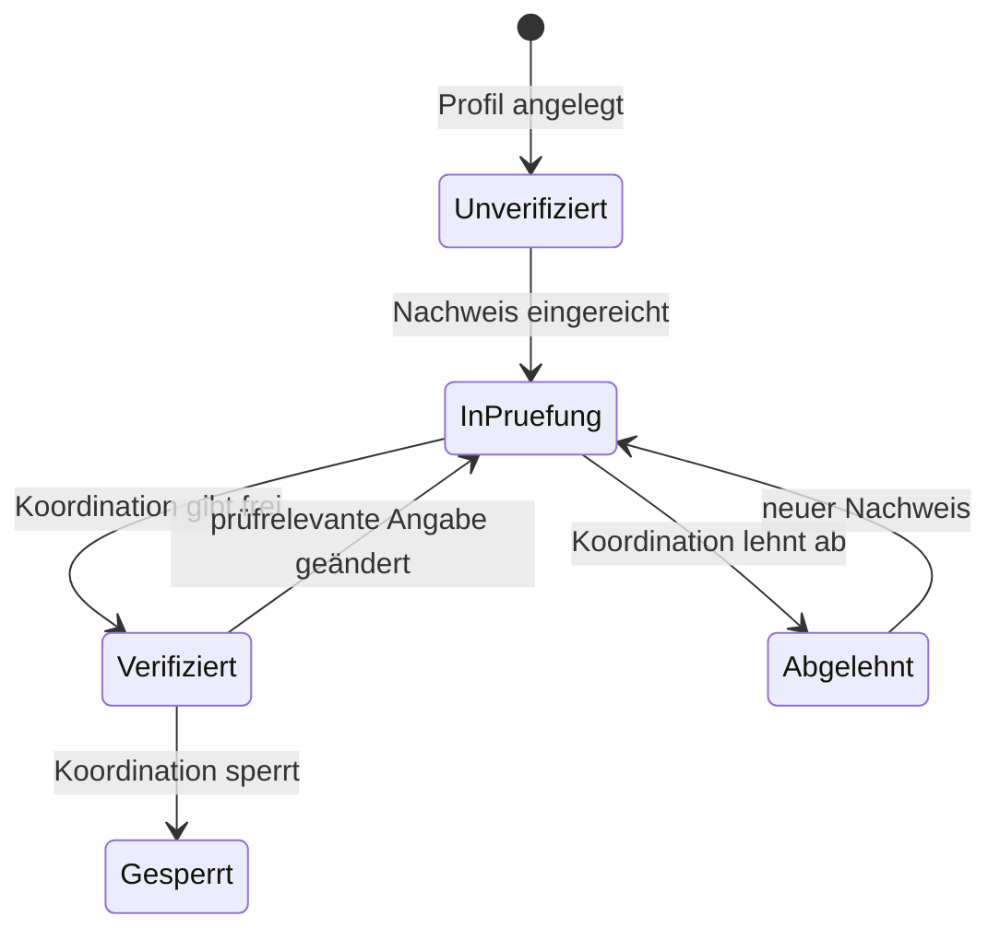

# Verifizierung

Helfende Personen und Betriebe weisen nach, wer sie sind, bevor die Koordination ihrer Region das Helferprofil freigibt. Die Plattform stützt sich dafür nur auf überprüfbare Angaben. Ausweisdokumente, Fotos oder andere Dateien nimmt sie nicht entgegen und speichert sie nicht.

## Nachweisarten

| Art | Wert | Prüfung beim Einreichen | Stand |
|---|---|---|---|
| `0` UID-Nummer | `CHE-123.456.788` | Format und Prüfziffer | umgesetzt |
| `1` Handelsregister | UID des eingetragenen Unternehmens, zum Beispiel `CHE-123.456.788 HR` | Format und Prüfziffer; den Eintrag prüft die Koordination im Handelsregister (Zefix) | umgesetzt |
| `2` bestätigte Telefonnummer, `3` bestätigte E-Mail-Adresse, `4` Referenz | | | folgt |

Arten, die noch nicht unterstützt sind, ergeben `400` mit `"feld": "art"`.

## UID-Nummer

Die Unternehmens-Identifikationsnummer besteht aus «CHE» und neun Ziffern; die letzte ist eine Prüfziffer.

| Schritt | Regel |
|---|---|
| Format | `CHE-123.456.788`, `CHE123456788` oder mit Leerzeichen; Gross- und Kleinschreibung egal; ein Zusatz `HR`, `MWST`, `TVA`, `IVA`, `RC` oder `RI` ist erlaubt |
| Prüfziffer | Summe der ersten acht Ziffern mal 5, 4, 3, 2, 7, 6, 5, 4; Prüfziffer = 11 − (Summe mod 11); 11 wird zu 0, 10 gibt es nicht |
| Gespeichert | immer in der Form `CHE-123.456.788`, ohne Zusatz |

Beispiel `CHE-123.456.788`: 1·5 + 2·4 + 3·3 + 4·2 + 5·7 + 6·6 + 7·5 + 8·4 = 168; 168 mod 11 = 3; 11 − 3 = 8.

## Ablauf



| Regel | Umsetzung |
|---|---|
| Status des Profils | `verifizierung` im Helferprofil: 0 unverifiziert, 1 in Prüfung, 2 verifiziert, 3 abgelehnt, 4 gesperrt |
| Einreichen | setzt den Nachweis und das Profil auf «in Prüfung» |
| Erneut einreichen | ein offener Nachweis derselben Art wird ersetzt, nicht verdoppelt |
| Prüfrelevante Änderung | ändern sich Typ, Betriebsname, Postleitzahl, Ort, Adresse oder Fähigkeiten eines verifizierten Profils, steht es wieder in Prüfung; Preise, Beschreibung und Radius nicht |
| Gesperrt | ein gesperrtes Profil kann keine Nachweise einreichen (`403`) |
| Freigabe | prüft und entscheidet die Koordination der Region |

## Datenschutz

| Schutz | Umsetzung |
|---|---|
| Keine Ausweisdokumente | die Schnittstelle nimmt nur JSON an; ein Upload (`multipart/form-data`) ergibt `415`, nichts wird gespeichert |
| Nur nötige Angaben | gespeichert werden Art, normalisierter Wert, Status, Zeitpunkte und eine Bemerkung der Koordination |
| Mandantentrennung | jeder Nachweis trägt die Region des Profils; die Koordination sieht nur ihre Region |
| Protokoll | `Verifizierung.Eingereicht` mit Kennung und Art, ohne den Wert |

## Schnittstelle

| Methode | Pfad | Rolle | Zweck |
|---|---|---|---|
| POST | `/api/verifizierungen` | Helfende | Nachweis einreichen |
| GET | `/api/verifizierungen/meine` | Helfende | eigene Nachweise, neueste zuerst |

```
POST /api/verifizierungen
Authorization: Bearer <token>
Content-Type: application/json

{ "art": 0, "nachweiswert": "che 123 456 788" }
```

Antwort `200`:

```
{ "id": "…", "helferProfilId": "…", "anzeigename": "…", "art": 0, "nachweiswert": "CHE-123.456.788",
  "status": 1, "bemerkung": null, "eingereichtAm": "…", "geprueftAm": null }
```

Ohne Helferprofil folgt `400`; ein fehlender Wert oder eine ungültige UID ergibt `400` mit `"feld": "nachweiswert"`.

## Tests

| Test | Prüft |
|---|---|
| Einheitentests `UidTests` | gültige Schreibweisen, Normalisierung, Prüfziffer 0, falsche Prüfziffer, nicht vergebene Nummern (Rechnung 10), falsche Formate |
| Schnittstellentests `tests/api/verifizierung.test.mjs` | Rollen, ohne Profil, UID und Handelsregister, Profil in Prüfung, ungültige Nachweise ohne Speicherung, Ersetzen statt Verdoppeln, Upload abgewiesen (`415`), Protokoll ohne Wert |
| Rauchtest | UID einreichen und normalisieren, falsche Prüfziffer, Upload abgewiesen |
