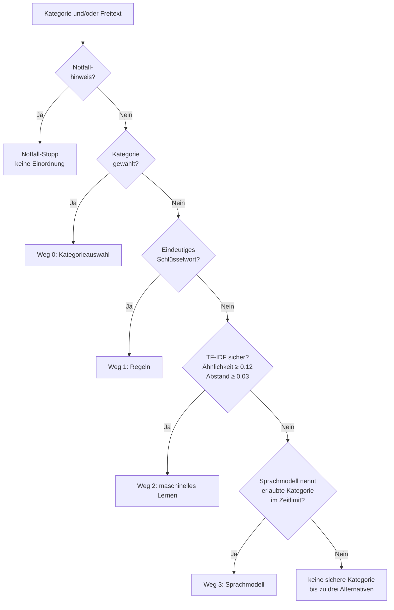

# Verständniskette

Die Verständniskette ordnet eine Anfrage einer der zehn Kategorien zu. Sie läuft nach der [Notfallprüfung](notfallpruefung.md); bei einem Notfall-Stopp wird nicht eingeordnet.

## Stufen



| Stufe | Weg | Entscheid | Sicherheit |
|---|---|---|---|
| 1 | `0` Kategorieauswahl | die gewählte Kategorie gilt immer, auch wenn der Freitext etwas anderes nahelegt | `1.0` |
| 2 | `1` Regeln | eindeutige Schlüsselwörter in Deutsch, Französisch, Italienisch und Englisch | `0.7` bis `0.95` |
| 3 | `2` maschinelles Lernen | TF-IDF-Klassifikator mit Kosinusähnlichkeit, trainiert mit fiktiven Beispielen | Ähnlichkeit zur Kategorie |
| 4 | `3` Sprachmodell | lokales Sprachmodell (Ollama), nur wenn die Stufen 1 bis 3 offen bleiben | keine (`null`) |

Ohne sicheres Ergebnis bleibt die Kategorie leer, die Begründung bittet darum, eine Kategorie aus der Liste zu wählen, und `alternativen` nennt die bis zu drei ähnlichsten Kategorien.

## Regeln

Die Begriffe stehen je Kategorie in [`Schluesselwortregeln.cs`](../backend/src/Soforthilfe.Dienste/Verstaendnis/Schluesselwortregeln.cs), in der aufbereiteten Form der [Notfallprüfung](notfallpruefung.md) (Kleinschreibung, Umlaute als ae/oe/ue, ohne Akzente).

| Regel | Beispiel |
|---|---|
| Begriffe bis 4 Zeichen nur als ganzes Wort | «auto» passt auf «Mein Auto», nicht auf «Autobahn» |
| Begriffe mit 5 oder 6 Zeichen als Wortanfang | «katze» passt auf «Katzen» |
| Längere Begriffe auch im Wort | «schluessel» passt auf «Hausschlüssel» |
| Begriffe mit Leerzeichen als Wortfolge | «locked out», «kein strom» |
| Eine Kategorie hat mehr Treffer als jede andere | «Nachbar hat den Schlüssel im Schloss abgebrochen» ergibt Schlüsseldienst (2 zu 1) |
| Gleich viele Treffer in zwei Kategorien | «Katze im Auto» entscheidet nicht |

Sicherheit: `0.7 + 0.1 × Treffer`, höchstens `0.95`; gibt es Treffer in einer weiteren Kategorie, `0.1` weniger. Die Begründung nennt das erste Schlüsselwort so, wie es geschrieben wurde, zum Beispiel «Erkannt über das Schlüsselwort «Heizung».».

## Maschinelles Lernen

Der Klassifikator in [`TfIdfKlassifikator.cs`](../backend/src/Soforthilfe.Dienste/Verstaendnis/TfIdfKlassifikator.cs) kommt ohne externe Bibliothek aus und wird beim Start einmal trainiert.

| Schritt | Umsetzung |
|---|---|
| Trainingsdaten | 184 fiktive Sätze auf Deutsch und Französisch, mindestens 17 je Kategorie, ohne echte Anfragen und ohne Personendaten ([`Trainingsdaten.cs`](../backend/src/Soforthilfe.Dienste/Verstaendnis/Trainingsdaten.cs)) |
| Zerlegen | Aufbereitung wie bei der Notfallprüfung, Wörter mit mehr als zwei Zeichen, ohne Stoppwörter, einfache Stammform («Heizungen» zu «heiz») |
| Gewichte | Termhäufigkeit mal geglättete inverse Dokumenthäufigkeit `ln((N + 1) / (n + 1)) + 1` |
| Modell | je Kategorie ein Schwerpunktvektor, der Mittelwert der Beispiele, auf Länge 1 gebracht |
| Entscheid | Kosinusähnlichkeit zu allen Kategorien; sicher, wenn die beste mindestens `0.12` erreicht und mindestens `0.03` vor der zweitbesten liegt |

Die Begründung nennt Ähnlichkeit und Abstand, zum Beispiel «Klassifikation über maschinelles Lernen: Ähnlichkeit 0.29 zur Kategorie «Lieferung Apotheke und Einkauf», Abstand zur zweitbesten Kategorie 0.29.».

## Sprachmodell

Die letzte Stufe fragt ein lokal betriebenes Sprachmodell ([`Sprachmodell.cs`](../backend/src/Soforthilfe.Dienste/Verstaendnis/Sprachmodell.cs)). Es läuft nur, wenn Regeln und maschinelles Lernen nicht sicher entscheiden; die meisten Anfragen erreichen es nie.

| Punkt | Umsetzung |
|---|---|
| Betrieb | Ollama als Container im Profil `sprachmodell`, Port nur auf dem eigenen Rechner (`127.0.0.1`) |
| Anbindung | nur über die konfigurierte Adresse `OLLAMA_BASE_URL`; ohne Adresse ist die Stufe ausgeschaltet |
| Datenschutz | der Freitext geht nur an den eigenen Ollama-Dienst, nie an Dritte, und wird dort nicht gespeichert |
| Modell | `OLLAMA_MODELL`, Standard `llama3.2:3b` (klein und schnell auf einem Rechner ohne Grafikkarte) |
| Anweisung | erlaubte Kennungen mit Bezeichnung; Antwort nur als JSON `{"kategorie":"<kennung>"}` oder `{"kategorie":null}`; Temperatur 0, höchstens 60 Token |
| Prüfung der Antwort | nur erlaubte Kennungen zählen; unbekannte, fehlende oder unlesbare Antworten ergeben keine Kategorie |
| Geschwindigkeit | Zeitlimit `OLLAMA_ZEITLIMIT_SEKUNDEN` (Standard 10), gleiche Texte aus dem Zwischenspeicher, nach einem Fehler eine Minute ohne Anfrage an das Modell, Vorladen des Modells nach dem Start |
| Ohne Antwort | die Kette bietet die drei ähnlichsten Kategorien zur Auswahl an, wie ohne Sprachmodell |

Die Begründung lautet «Eingeordnet durch das lokale Sprachmodell, weil Regeln und maschinelles Lernen nicht sicher entschieden haben.»; eine Sicherheit nennt das Modell nicht.

Starten für die Entwicklung (Werte aus der `.env`, Vorlage `.env.example`):

```
docker compose --profile sprachmodell up -d ollama
docker compose exec ollama ollama pull llama3.2:3b
```

Die CI startet kein Sprachmodell; dort endet die Kette beim maschinellen Lernen. Die Schnittstellentests lassen beide Fälle zu.

## Kalibrierungssatz

100 Sätze, je Kategorie sieben deutsche und drei französische, die nicht in den Trainingsdaten stehen ([`TfIdfKlassifikatorTests.cs`](../backend/tests/Soforthilfe.Tests/TfIdfKlassifikatorTests.cs)). Regeln, Trainingsdaten und Schwellen wurden an diesem Satz abgestimmt; die Werte zeigen deshalb den abgestimmten Stand und sind keine unabhängige Messung. Die Einheitentests sichern diesen Stand gegen Rückschritte ab.

| Verfahren | richtig | falsch | offen |
|---|---|---|---|
| Regeln und maschinelles Lernen (Kette) | 98 | 1 | 1 |
| maschinelles Lernen allein | 79 | 6 | 15 |

Mindestwerte im Test: Kette mindestens 95 richtig und höchstens 2 falsch, maschinelles Lernen allein mindestens 75 richtig und höchstens 7 falsch. Bleibt das Ergebnis offen, wird um die Wahl einer Kategorie gebeten.

## Dringlichkeit

Die Dringlichkeit (`0` tief, `1` mittel, `2` hoch) folgt aus Text und Kategorie ([`Dringlichkeit.cs`](../backend/src/Soforthilfe.Dienste/Verstaendnis/Dringlichkeit.cs)). Eine beim Erfassen ausdrücklich gewählte Dringlichkeit gilt immer.

| Reihenfolge | Regel | Beispiel |
|---|---|---|
| 1 | Wörter für «keine Eile» ergeben tief | «keine Eile», «nicht dringend», «nächste Woche», «pas pressé» |
| 2 | Wörter für Eile oder besondere Lage ergeben hoch | «sofort», «heute noch», «kalt», «kein Strom», «Kinder», «urgent» |
| 3 | ohne Signalwort die übliche Dringlichkeit der Kategorie | Schlüsseldienst und Pannenhilfe hoch, Transport- und Umzugshilfe tief, alle anderen mittel |

Die Wortgrenzen gelten wie bei den Regeln: «kalt» passt nicht auf «Kaltwasser». Bei einem Notfall-Stopp gibt es keine Dringlichkeit, sondern den Hinweis auf 144. Die Begründung nennt das Signalwort, zum Beispiel «Dringlichkeit hoch wegen «sofort».».

## Schnittstelle

```
POST /api/anfragen/verstehen
Content-Type: application/json

{ "freitext": "Die Heizung ist ausgefallen." }
```

Antwort `200`:

```
{ "notfall": false, "notfallGrund": null, "notfallHinweis": null,
  "kategorieId": "…", "kategorie": "Sanitär, Heizung, Elektro", "code": "sanitaer-elektro",
  "bezahlpflichtig": true, "erfassungsweg": 1, "konfidenz": 0.8,
  "begruendung": "Erkannt über das Schlüsselwort «Heizung».", "alternativen": [],
  "prioritaet": 1, "prioritaetGrund": "Dringlichkeit mittel, ohne Hinweis auf Eile." }
```

In der Oberfläche zeigt «Wo und wann?» die erkannte Kategorie mit Begründung; die Person kann sie ändern oder bei Unsicherheit eine der Alternativen wählen. Eine geänderte Kategorie gilt als Kategorieauswahl.

Beim Erfassen ohne gewählte Kategorie (`POST /api/anfragen` nur mit Freitext) speichert die Anfrage die erkannte Kategorie; ohne sicheres Ergebnis bleibt sie leer. Ohne `prioritaet` speichert sie die abgeleitete Dringlichkeit.

## Tests

| Test | Prüft |
|---|---|
| Einheitentests `SchluesselwortregelnTests` | Kategorien aus eindeutigen Schlüsselwörtern, Wortgrenzen, Gleichstand, Mehrheit der Treffer, Sicherheit, genanntes Schlüsselwort |
| Einheitentests `SprachmodellTests` | ausgeschaltet ohne Adresse, erlaubte Kennung, Anfrage im JSON-Modus, unbekannte und unlesbare Antworten, Zwischenspeicher, Pause nach einem Fehler, Zeitlimit, Anweisung mit allen Kategorien |
| Einheitentests `DringlichkeitTests` | Signalwörter für Eile und für «keine Eile», Vorrang des Texts vor der Kategorie, übliche Dringlichkeit je Kategorie, Wortgrenzen, Begründung |
| Schnittstellentests `tests/api/dringlichkeit.test.mjs` | Dringlichkeit mit Begründung im Verständnis-Schritt, keine bei Notfall, abgeleitet beim Erfassen, gewählte Dringlichkeit gilt |
| Einheitentests `TfIdfKlassifikatorTests` | Kalibrierungssatz mit Kette und maschinellem Lernen allein, kein Trainingsbeispiel falsch, Entscheid ohne Schlüsselwort, offen bei knappem Abstand mit Rangfolge, unbekannte Wörter, Stammform |
| Schnittstellentests `tests/api/verstaendnis.test.mjs` | gewählte Kategorie hat Vorrang, Regeln in vier Sprachen mit Begründung, maschinelles Lernen mit Ähnlichkeit und Abstand, bis zu drei Alternativen bei knappem Ergebnis oder Entscheid des Sprachmodells, ohne Ergebnis Bitte um Auswahl, keine Einordnung bei Notfall, Anfrage nur mit Freitext erhält die Kategorie |
