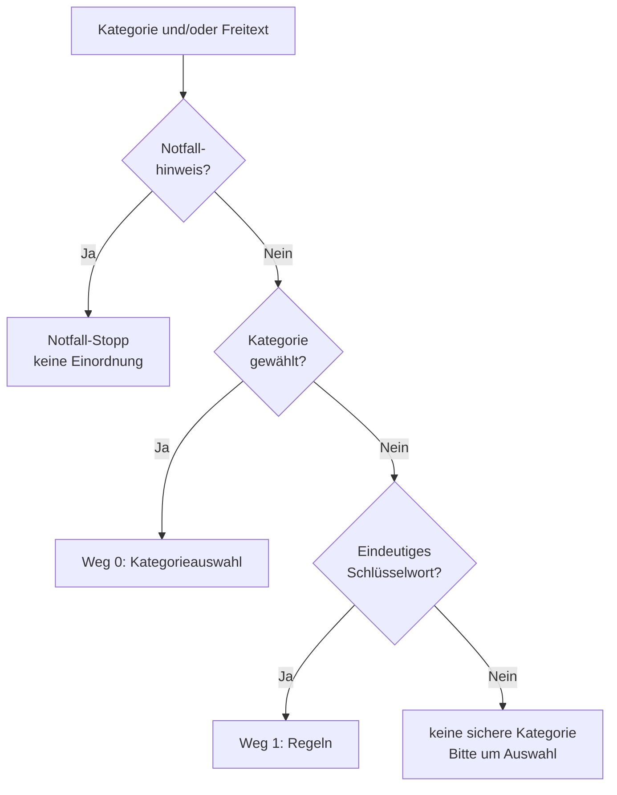

# Verständniskette

Die Verständniskette ordnet eine Anfrage einer der zehn Kategorien zu. Sie läuft nach der [Notfallprüfung](notfallpruefung.md); bei einem Notfall-Stopp wird nicht eingeordnet.

## Stufen



| Stufe | Weg | Entscheid | Sicherheit |
|---|---|---|---|
| 1 | `0` Kategorieauswahl | die gewählte Kategorie gilt immer, auch wenn der Freitext etwas anderes nahelegt | `1.0` |
| 2 | `1` Regeln | eindeutige Schlüsselwörter in Deutsch, Französisch, Italienisch und Englisch | `0.7` bis `0.95` |

Ohne sicheres Ergebnis bleibt die Kategorie leer, und die Begründung bittet darum, eine Kategorie aus der Liste zu wählen.

## Regeln

Die Begriffe stehen je Kategorie in [`Schluesselwortregeln.cs`](../backend/src/Soforthilfe.Dienste/Verstaendnis/Schluesselwortregeln.cs), in der aufbereiteten Form der [Notfallprüfung](notfallpruefung.md) (Kleinschreibung, Umlaute als ae/oe/ue, ohne Akzente).

| Regel | Beispiel |
|---|---|
| Begriffe bis 4 Zeichen nur als ganzes Wort | «auto» passt auf «Mein Auto», nicht auf «Autobahn» |
| Begriffe mit 5 oder 6 Zeichen als Wortanfang | «katze» passt auf «Katzen» |
| Längere Begriffe auch im Wort | «schluessel» passt auf «Hausschlüssel» |
| Begriffe mit Leerzeichen als Wortfolge | «locked out», «kein strom» |
| Eine Kategorie hat mehr Treffer als jede andere | «Nachbar hat den Schlüssel im Schloss abgebrochen» ergibt Schlüsseldienst (2 zu 1) |
| Gleich viele Treffer in zwei Kategorien | «Katze im Auto» entscheidet nicht |

Sicherheit: `0.7 + 0.1 × Treffer`, höchstens `0.95`; gibt es Treffer in einer weiteren Kategorie, `0.1` weniger. Die Begründung nennt das erste Schlüsselwort so, wie es geschrieben wurde, zum Beispiel «Erkannt über das Schlüsselwort «Heizung».».

## Schnittstelle

```
POST /api/anfragen/verstehen
Content-Type: application/json

{ "freitext": "Die Heizung ist ausgefallen." }
```

Antwort `200`:

```
{ "notfall": false, "notfallGrund": null, "notfallHinweis": null,
  "kategorieId": "…", "kategorie": "Sanitär, Heizung, Elektro", "code": "sanitaer-elektro",
  "bezahlpflichtig": true, "erfassungsweg": 1, "konfidenz": 0.8,
  "begruendung": "Erkannt über das Schlüsselwort «Heizung».", "alternativen": [] }
```

Beim Erfassen ohne gewählte Kategorie (`POST /api/anfragen` nur mit Freitext) speichert die Anfrage die erkannte Kategorie; ohne sicheres Ergebnis bleibt sie leer.

## Tests

| Test | Prüft |
|---|---|
| Einheitentests `SchluesselwortregelnTests` | Kategorien aus eindeutigen Schlüsselwörtern, Wortgrenzen, Gleichstand, Mehrheit der Treffer, Sicherheit, genanntes Schlüsselwort |
| Schnittstellentests `tests/api/verstaendnis.test.mjs` | gewählte Kategorie hat Vorrang, Regeln in vier Sprachen mit Begründung, ohne Ergebnis Bitte um Auswahl, keine Einordnung bei Notfall, Anfrage nur mit Freitext erhält die Kategorie |
