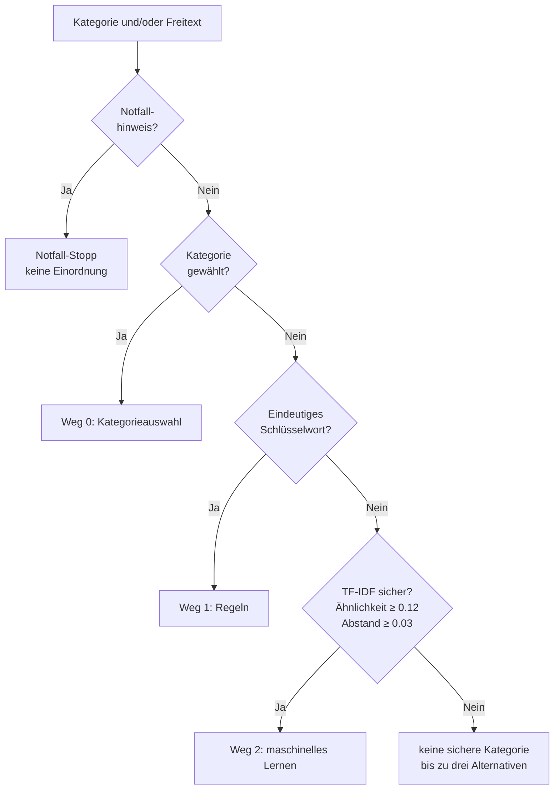

# Verständniskette

Die Verständniskette ordnet eine Anfrage einer der zehn Kategorien zu. Sie läuft nach der [Notfallprüfung](notfallpruefung.md); bei einem Notfall-Stopp wird nicht eingeordnet.

## Stufen



| Stufe | Weg | Entscheid | Sicherheit |
|---|---|---|---|
| 1 | `0` Kategorieauswahl | die gewählte Kategorie gilt immer, auch wenn der Freitext etwas anderes nahelegt | `1.0` |
| 2 | `1` Regeln | eindeutige Schlüsselwörter in Deutsch, Französisch, Italienisch und Englisch | `0.7` bis `0.95` |
| 3 | `2` maschinelles Lernen | TF-IDF-Klassifikator mit Kosinusähnlichkeit, trainiert mit fiktiven Beispielen | Ähnlichkeit zur Kategorie |

Ohne sicheres Ergebnis bleibt die Kategorie leer, die Begründung bittet darum, eine Kategorie aus der Liste zu wählen, und `alternativen` nennt die bis zu drei ähnlichsten Kategorien.

## Regeln

Die Begriffe stehen je Kategorie in [`Schluesselwortregeln.cs`](../backend/src/Soforthilfe.Dienste/Verstaendnis/Schluesselwortregeln.cs), in der aufbereiteten Form der [Notfallprüfung](notfallpruefung.md) (Kleinschreibung, Umlaute als ae/oe/ue, ohne Akzente).

| Regel | Beispiel |
|---|---|
| Begriffe bis 4 Zeichen nur als ganzes Wort | «auto» passt auf «Mein Auto», nicht auf «Autobahn» |
| Begriffe mit 5 oder 6 Zeichen als Wortanfang | «katze» passt auf «Katzen» |
| Längere Begriffe auch im Wort | «schluessel» passt auf «Hausschlüssel» |
| Begriffe mit Leerzeichen als Wortfolge | «locked out», «kein strom» |
| Eine Kategorie hat mehr Treffer als jede andere | «Nachbar hat den Schlüssel im Schloss abgebrochen» ergibt Schlüsseldienst (2 zu 1) |
| Gleich viele Treffer in zwei Kategorien | «Katze im Auto» entscheidet nicht |

Sicherheit: `0.7 + 0.1 × Treffer`, höchstens `0.95`; gibt es Treffer in einer weiteren Kategorie, `0.1` weniger. Die Begründung nennt das erste Schlüsselwort so, wie es geschrieben wurde, zum Beispiel «Erkannt über das Schlüsselwort «Heizung».».

## Maschinelles Lernen

Der Klassifikator in [`TfIdfKlassifikator.cs`](../backend/src/Soforthilfe.Dienste/Verstaendnis/TfIdfKlassifikator.cs) kommt ohne externe Bibliothek aus und wird beim Start einmal trainiert.

| Schritt | Umsetzung |
|---|---|
| Trainingsdaten | 184 fiktive Sätze auf Deutsch und Französisch, mindestens 17 je Kategorie, ohne echte Anfragen und ohne Personendaten ([`Trainingsdaten.cs`](../backend/src/Soforthilfe.Dienste/Verstaendnis/Trainingsdaten.cs)) |
| Zerlegen | Aufbereitung wie bei der Notfallprüfung, Wörter mit mehr als zwei Zeichen, ohne Stoppwörter, einfache Stammform («Heizungen» zu «heiz») |
| Gewichte | Termhäufigkeit mal geglättete inverse Dokumenthäufigkeit `ln((N + 1) / (n + 1)) + 1` |
| Modell | je Kategorie ein Schwerpunktvektor, der Mittelwert der Beispiele, auf Länge 1 gebracht |
| Entscheid | Kosinusähnlichkeit zu allen Kategorien; sicher, wenn die beste mindestens `0.12` erreicht und mindestens `0.03` vor der zweitbesten liegt |

Die Begründung nennt Ähnlichkeit und Abstand, zum Beispiel «Klassifikation über maschinelles Lernen: Ähnlichkeit 0.29 zur Kategorie «Lieferung Apotheke und Einkauf», Abstand zur zweitbesten Kategorie 0.29.».

## Kalibrierungssatz

100 Sätze, je Kategorie sieben deutsche und drei französische, die nicht in den Trainingsdaten stehen ([`TfIdfKlassifikatorTests.cs`](../backend/tests/Soforthilfe.Tests/TfIdfKlassifikatorTests.cs)). Regeln, Trainingsdaten und Schwellen wurden an diesem Satz abgestimmt; die Werte zeigen deshalb den abgestimmten Stand und sind keine unabhängige Messung. Die Einheitentests sichern diesen Stand gegen Rückschritte ab.

| Verfahren | richtig | falsch | offen |
|---|---|---|---|
| Regeln und maschinelles Lernen (Kette) | 98 | 1 | 1 |
| maschinelles Lernen allein | 79 | 6 | 15 |

Mindestwerte im Test: Kette mindestens 95 richtig und höchstens 2 falsch, maschinelles Lernen allein mindestens 75 richtig und höchstens 7 falsch. Bleibt das Ergebnis offen, wird um die Wahl einer Kategorie gebeten.

## Schnittstelle

```
POST /api/anfragen/verstehen
Content-Type: application/json

{ "freitext": "Die Heizung ist ausgefallen." }
```

Antwort `200`:

```
{ "notfall": false, "notfallGrund": null, "notfallHinweis": null,
  "kategorieId": "…", "kategorie": "Sanitär, Heizung, Elektro", "code": "sanitaer-elektro",
  "bezahlpflichtig": true, "erfassungsweg": 1, "konfidenz": 0.8,
  "begruendung": "Erkannt über das Schlüsselwort «Heizung».", "alternativen": [] }
```

Beim Erfassen ohne gewählte Kategorie (`POST /api/anfragen` nur mit Freitext) speichert die Anfrage die erkannte Kategorie; ohne sicheres Ergebnis bleibt sie leer.

## Tests

| Test | Prüft |
|---|---|
| Einheitentests `SchluesselwortregelnTests` | Kategorien aus eindeutigen Schlüsselwörtern, Wortgrenzen, Gleichstand, Mehrheit der Treffer, Sicherheit, genanntes Schlüsselwort |
| Einheitentests `TfIdfKlassifikatorTests` | Kalibrierungssatz mit Kette und maschinellem Lernen allein, kein Trainingsbeispiel falsch, Entscheid ohne Schlüsselwort, offen bei knappem Abstand mit Rangfolge, unbekannte Wörter, Stammform |
| Schnittstellentests `tests/api/verstaendnis.test.mjs` | gewählte Kategorie hat Vorrang, Regeln in vier Sprachen mit Begründung, maschinelles Lernen mit Ähnlichkeit und Abstand, bis zu drei Alternativen bei knappem Ergebnis, ohne Ergebnis Bitte um Auswahl, keine Einordnung bei Notfall, Anfrage nur mit Freitext erhält die Kategorie |
